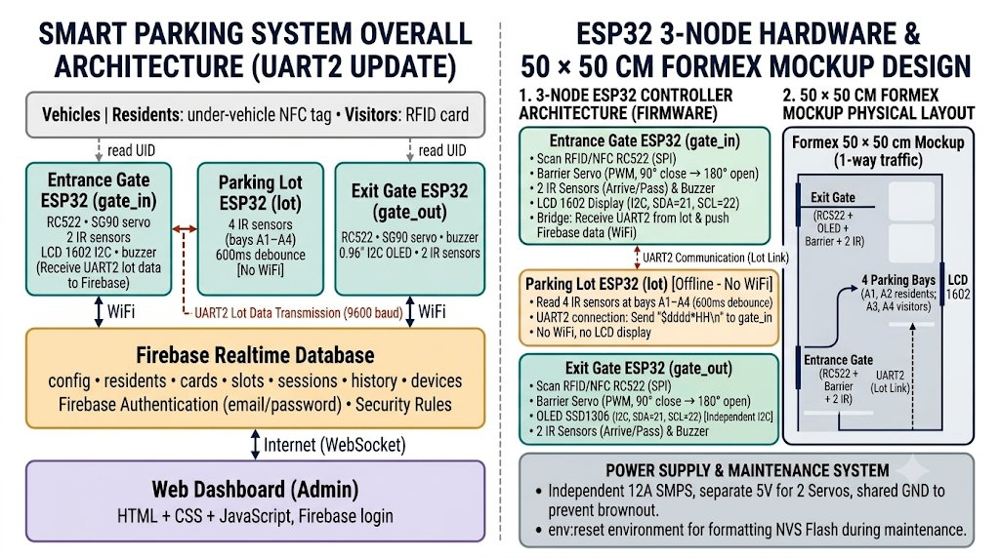

# 🚗 IoT Smart Parking System (ESP32 · Firebase RTDB · Web Dashboard)

[](https://platformio.org/)
[](https://www.espressif.com/)
[](https://firebase.google.com/)
[](https://tailwindcss.com/)
[](LICENSE)

An **end-to-end distributed IoT Smart Parking System** integrating multi-microcontroller firmware (**ESP32**), a real-time cloud backbone (**Firebase Realtime Database**), and an administrative **Web Management Dashboard** featuring automated **VietQR** payment integration.

---

## 📸 System Architecture & Physical Mockup Layout



---

## 🌟 Key Engineering Highlights

### 1. 3-Node Distributed Multi-MCU Architecture
* **Entrance Gate ESP32 (`gate_in`):** Controls the entrance barrier servo (PWM $90^\circ \to 180^\circ$), RFID RC522 scanner, dual IR obstacle sensors, active buzzer, and I2C LCD 1602 display. Also acts as an IoT bridge, collecting parking bay data via UART2 and pushing it to Firebase.
* **Exit Gate ESP32 (`gate_out`):** Manages the exit barrier, RFID scanner, dual IR sensors, active buzzer, and I2C 0.96" SSD1306 OLED display. Computes parking fees and coordinates cashless VietQR payment with the Web app.
* **Parking Lot ESP32 (`lot`):** Operates completely offline without WiFi. Reads 4 optical IR sensors (Bays A1–A4) with 600ms software debounce, packing bay occupancy into a custom ASCII frame (`$dddd*HH\n` with XOR checksum) transmitted over **UART2** (9600 baud) to `gate_in`.

### 2. High Availability & Offline-First Design (Fault Tolerance)
* **Flash Blob Cache:** Resident profiles, registered guest cards, and billing configurations are cached in ESP32 NVS Flash as binary blobs. If WiFi or Firebase disconnects, gates continue verifying cards and operating seamlessly offline.
* **Persistent Circular Queue in Flash:** Unsent write operations (`Set`, `Push`, `Delete`) during network outages are queued in a persistent circular queue (up to 30 transactions) stored in NVS Flash. When connectivity resumes, entries are flushed sequentially with exponential backoff ($2\text{s}, 4\text{s}, 8\text{s}, \dots, 30\text{s}$). Data is preserved even across power loss.
* **Step-by-Step Cache Synchronization:** Synchronizing config, residents, and cards is segmented across loop iterations to prevent CPU blocking.

### 3. CPU Prioritization (`setBusy`)
* Heavy background tasks (WiFi scanning, queue flushing, cache sync) are automatically paused while a vehicle traverses the barrier or during card transactions, giving 100% CPU priority to optical sensors and servo motion.

### 4. Anti-Passback & Capacity Enforcement
* **Anti-Passback:** Prevents card sharing by ensuring a vehicle already recorded inside (`trongBai = true`) cannot re-enter, and a vehicle outside cannot exit.
* **Dynamic Capacity Control:** Validates active guest sessions against `khachToiDa`. If visitor slots are full, entry is rejected and displayed on LCD.

### 5. Dual-IR Safety Interlock Barrier (Zero Pinching Hazard)
* Two sequential optical IR sensors (`IR_ARRIVE` and `IR_PASS`) track vehicle trajectory.
* The servo barrier only lowers ($90^\circ$) once the vehicle has completely cleared `IR_PASS` for a continuous 1-second debounce window.
* **Safety Timeout:** If a barrier opens but no car enters within 20 seconds, it automatically closes and voids the transaction.

### 6. Automated VietQR Payment & 120s Paid Grace Period
* **Real-time Fee Calculation:** Evaluates parking duration based on UTC millisecond timestamps, charging per configurable block (e.g., 60-min blocks, 5,000 VND minimum charge).
* **Dynamic VietQR:** When a visitor swipes at the exit gate, the system prompts payment on OLED and pushes the order to Firebase. The Web Dashboard detects the pending order and renders a dynamic Napas247 VietQR code.
* **120-Second Paid Grace Period:** If payment succeeds and the barrier opens, but the vehicle stalls or fails to exit before the 20s timeout, the visitor can re-swipe within 2 minutes to re-open the barrier without paying twice.

### 7. 100% Non-Blocking Software Architecture
* No blocking `delay()` calls are used. Active buzzer melodies, servo angles, IR debounce filters, RFID polling, and OLED/LCD redraws run concurrently on soft timers using `millis()`.

---

## 🎥 Demonstration Video

<!-- You can replace the link below with your YouTube link or GitHub video upload -->
[](https://www.youtube.com/)

> 💡 **Tip:** To embed an MP4 directly on GitHub, edit this README on GitHub, drag & drop your video file into the markdown editor, and GitHub will auto-generate an embedded player tag!

---

## 🔌 Hardware Specifications & Pinout

### 1. Entrance Gate ESP32 (`gate_in`)
| Component | ESP32 Pin | Protocol / Mode | Description |
| :--- | :--- | :--- | :--- |
| **MFRC522 RFID** | SCK: 18, MISO: 19, MOSI: 23, SS: 5, RST: 4 | Hardware SPI | Scans resident RFID tags & visitor cards |
| **Barrier Servo** | GPIO 13 | PWM 50Hz | $90^\circ$ (Closed), $180^\circ$ (Open) |
| **IR Sensor (Arrive)** | GPIO 32 | Digital In (Pull-up) | Detects vehicle approaching gate |
| **IR Sensor (Pass)** | GPIO 33 | Digital In (Pull-up) | Detects vehicle past gate |
| **LCD 1602** | SDA: 21, SCL: 22 | I2C (50kHz, Addr: 0x27/0x3F) | Displays available visitor slots & slot guidance |
| **Active Buzzer** | GPIO 14 | Digital Out | Success / reject / timeout acoustic alerts |
| **Status LED** | GPIO 2 | Digital Out | Visual gate status indicator |
| **UART2 Link** | RX: 16, TX: 17 | Serial2 (9600 baud) | Receives bay occupancy from `lot` node |

### 2. Exit Gate ESP32 (`gate_out`)
| Component | ESP32 Pin | Protocol / Mode | Description |
| :--- | :--- | :--- | :--- |
| **MFRC522 RFID** | SCK: 18, MISO: 19, MOSI: 23, SS: 5, RST: 4 | Hardware SPI | Scans RFID cards for exit & billing |
| **Barrier Servo** | GPIO 13 | PWM 50Hz | $90^\circ$ (Closed), $180^\circ$ (Open) |
| **IR Sensor (Arrive)** | GPIO 32 | Digital In (Pull-up) | Detects car waiting to exit |
| **IR Sensor (Pass)** | GPIO 33 | Digital In (Pull-up) | Detects car cleared exit barrier |
| **OLED SSD1306 0.96"**| SDA: 21, SCL: 22 | I2C (400kHz, Addr: 0x3C) | Displays fee amount, QR payment prompt & status |
| **Active Buzzer** | GPIO 14 | Digital Out | Distinctive beep feedback patterns |
| **Status LED** | GPIO 2 | Digital Out | Visual gate status indicator |

### 3. Parking Lot ESP32 (`lot`)
| Component | ESP32 Pin | Mode | Description |
| :--- | :--- | :--- | :--- |
| **Bay A1 IR Sensor** | GPIO 32 | Digital In (Pull-up) | Resident Bay A1 (Active LOW on presence) |
| **Bay A2 IR Sensor** | GPIO 33 | Digital In (Pull-up) | Resident Bay A2 (Active LOW on presence) |
| **Bay A3 IR Sensor** | GPIO 25 | Digital In (Pull-up) | Visitor Bay A3 (Active LOW on presence) |
| **Bay A4 IR Sensor** | GPIO 26 | Digital In (Pull-up) | Visitor Bay A4 (Active LOW on presence) |
| **UART2 TX** | GPIO 17 | Serial2 (9600 baud) | Transmits `$dddd*HH\n` string to `gate_in` |

### 4. Power Supply & Electrical Safety
* **Independent 12A Switch-Mode Power Supply (SMPS):** Supplies regulated 5V power rails.
* **Dedicated Servo Power Rail:** Barrier servos run on dedicated lines separated from ESP32 logic power to eliminate voltage sags and MCU brownout resets during peak motor stall current.
* **Common Ground (GND):** All MCUs, sensors, servos, and peripherals share a unified ground plane.

---

## 📁 Repository Directory Structure

```
smart-parking-iot-system/
├── assets/
│   └── architecture_layout.jpg      # System architecture & 50x50 cm mockup layout
├── Smart_Parking_ESP32_Web/         # ESP32 PlatformIO Firmware Project
│   ├── include/
│   │   ├── secrets.example.h        # Template configuration for WiFi & Firebase
│   │   └── secrets.h                # Local credentials (git-ignored for security)
│   ├── lib/
│   │   └── ParkingCore/             # Shared library (WiFiMulti, NTP, Cache, Queue, Heartbeat)
│   ├── src/
│   │   ├── gate_in/                 # Entrance gate firmware & lot_link module
│   │   ├── gate_out/                # Exit gate firmware & payment handling
│   │   ├── lot/                     # Parking bay monitoring firmware (offline)
│   │   └── reset/                   # Flash NVS formatting utility
│   └── platformio.ini               # Multi-environment PlatformIO build configuration
├── Web/                             # Web Management Application
│   ├── index.html                   # Single-Page Management Dashboard (Tailwind CSS)
│   ├── Endgame_web_20_11.html       # Source HTML dashboard
│   ├── du_lieu_mau.json             # Sample database configuration
│   └── firebaseConfig.txt           # Firebase SDK reference snippet
├── Schematic/                       # Electrical Hardware Design
│   └── Schematic_System/            # Complete KiCad schematic project (.kicad_sch)
├── du_lieu_sach.json                # Clean Firebase initial seed database
└── README.md                        # Master project documentation
```

---

## 🚀 Getting Started

### Prerequisites
* [VS Code](https://code.visualstudio.com/) with the [PlatformIO IDE](https://platformio.org/install/ide?install=vscode) extension installed.
* [KiCad 8.x+](https://www.kicad.org/) (optional, to view or modify schematics).
* A free [Google Firebase](https://firebase.google.com/) project with **Realtime Database** enabled in `asia-southeast1`.

### 1. Configure Secrets
Navigate to `Smart_Parking_ESP32_Web/include/`:
```bash
cp include/secrets.example.h include/secrets.h
```
Edit `secrets.h` with your WiFi SSID, password, Firebase Web API Key, Database URL, and ESP32 service account credentials.

### 2. Flash Firmware via PlatformIO
Connect your ESP32 boards via USB and flash the target firmware environments:
```bash
# Flash Entrance Gate
pio run -e gate_in -t upload

# Flash Exit Gate
pio run -e gate_out -t upload

# Flash Parking Lot Node
pio run -e lot -t upload
```

### 3. Launch Web Dashboard
Open `Web/index.html` directly in any modern browser (or host it via GitHub Pages / Firebase Hosting). Sign in with your admin credentials to monitor live occupancy, incoming revenue, and manage resident cards.

---

## 👨‍💻 Author

* **Pham Duc Tri**
* **Email:** ductripham912@gmail.com
* **GitHub:** [@ductripham912-glitch](https://github.com/ductripham912-glitch)
* **Target Role:** Embedded Systems & IoT Firmware Engineer
